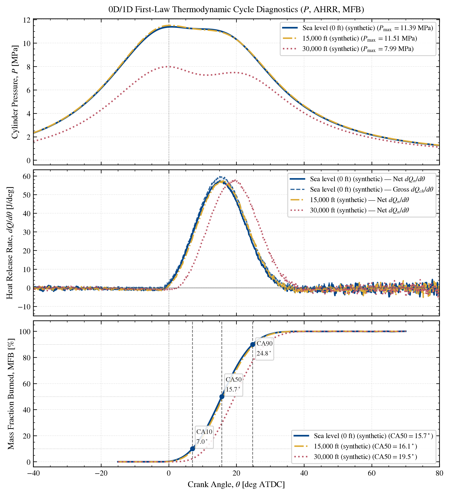
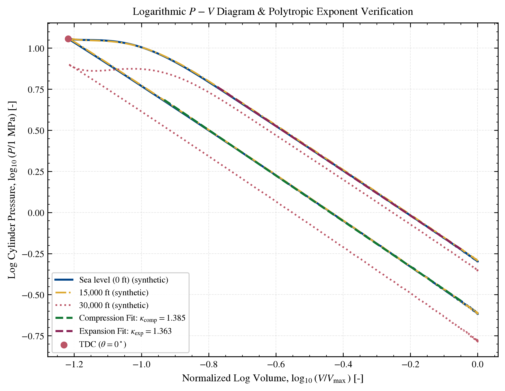
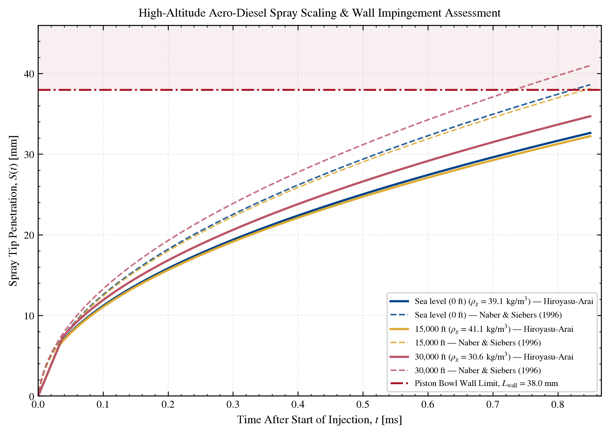
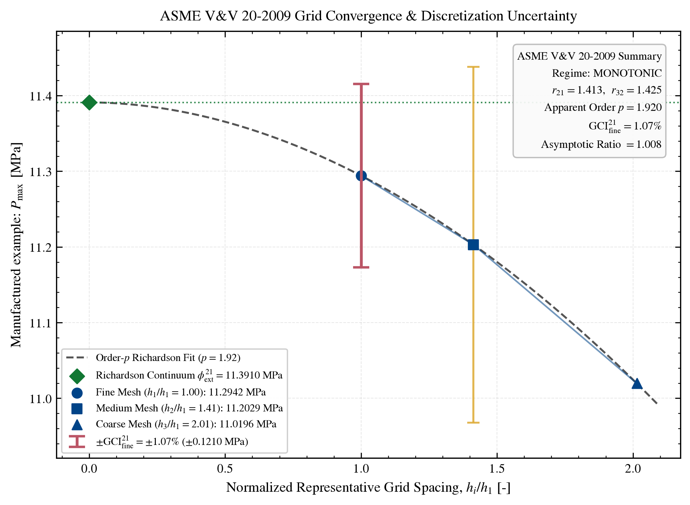

# Combusta

[](https://github.com/alpztel/combusta/actions/workflows/ci_validation.yml)
[](https://github.com/alpztel/combusta/releases/latest)
[](pyproject.toml)
[](LICENSE)
[](src/combusta/py.typed)
[](CITATION.cff)

**Combusta** is a Python library for the analysis of internal combustion engine cycles from simulation and test-bench data. It reduces crank-angle-resolved pressure traces to standard cycle metrics, compares engine configurations side by side, post-processes exhaust emissions, and quantifies numerical and validation uncertainty following ASME V&V 20. Thermodynamic properties are fuel-agnostic: any C<sub>x</sub>H<sub>y</sub>O<sub>z</sub> fuel, including hydrogen, is supported at any air-excess ratio, and every quantity is held in SI units.

> [!IMPORTANT]
> **Project status — 0.4.0 (alpha).** Every model is verified against closed-form solutions and published reference data (see [Verification](#verification)). The library has **not yet been validated against engine or CFD measurements**, and its readers have not yet been exercised on real ANSYS Forte output. Treat results as research-grade until such validation is available.

<details>
<summary><b>Türkçe özet</b></summary>

Combusta, içten yanmalı motor çevrimlerini simülasyon (ör. ANSYS Forte) ve test düzeneği verisinden analiz eden bir Python kütüphanesidir. Krank açısına bağlı basınç izlerinden IMEP, verim, özgül yakıt tüketimi, CA10/50/90 gibi standart çevrim metriklerini çıkarır; farklı motor konfigürasyonlarını yan yana karşılaştırır ve farkların sayısal belirsizlikten (GCI) büyük olup olmadığını raporlar.

- **Vaka dosyaları ve komut satırı:** her vaka bir `case.toml` ile tanımlanır; `combusta compare` girdilerin SHA-256 özetini içeren bir rapor üretir.
- **Eşleştirilmiş karşılaştırma:** avans taramaları aynı CA50'de ya da her konfigürasyonun kendi MBT avansında karşılaştırılır (`combusta matched`).
- **Ön yanma odası analizi:** ön oda ve ana oda, orifislerle bağlı iki hacim olarak incelenir; jet zamanlaması, jet kütlesi ve ısı salımı paylaşımı hesaplanır (`combusta prechamber`).
- **Ölçüm belirsizliği:** ÜÖN faz hatası, seviyeleme ofseti, kazanç hatası ve gürültünün metriklere etkisi hesaplanır (`combusta measurement`).
- Emisyon son işleme (ppm → g/kWh, emisyon indeksi, yanma verimi) ve ASME V&V 20 doğrulama (E = S − D, u<sub>val</sub>).

Termodinamik özellikler yakıttan bağımsızdır; hidrojen dahil her C<sub>x</sub>H<sub>y</sub>O<sub>z</sub> yakıtı her λ değerinde desteklenir. Tüm modeller analitik çözümlere ve literatür verisine karşı doğrulanmıştır; gerçek motor veya CFD verisiyle validasyon henüz yapılmamıştır.

</details>

## Contents

1. [Scope](#scope)
2. [Installation](#installation)
3. [Quick start](#quick-start)
4. [Package overview](#package-overview)
5. [Mathematical formulation](#mathematical-formulation)
6. [Verification](#verification)
7. [Example: synthetic altitude sweep](#example-synthetic-altitude-sweep)
8. [Assumptions and limitations](#assumptions-and-limitations)
9. [Roadmap](#roadmap)
10. [Development](#development)
11. [How to cite](#how-to-cite)
12. [License and third-party notices](#license-and-third-party-notices)
13. [References](#references)

## Scope

**What Combusta does**

- Builds a source-independent engine case (`EngineCase`) from CFD exports, test-bench traces, or 1D model output, with a geometry/volume consistency check that detects crank-angle offsets and geometry mismatches.
- Computes single-zone apparent and gross heat release with temperature- and composition-dependent gas properties, burn fractions, IMEP, indicated power, efficiency, and specific fuel consumption.
- Compares any number of cases against a baseline and flags which differences exceed the combined numerical uncertainty.
- Compares spark-timing sweeps of several configurations at matched CA50 or each at its own MBT timing.
- Analyzes pre-chamber engines as two volumes connected by orifices: pressure difference, jet timing and mass, and the heat release of each volume.
- Converts exhaust concentrations to specific emissions and emission indices, and estimates combustion efficiency from the chemical energy left in the exhaust.
- Estimates discretization uncertainty with the Grid Convergence Index (Celik et al., 2008), propagates pressure-measurement errors into the cycle metrics, and performs ASME V&V 20 validation comparisons.
- Reads cases from TOML files and writes traceable reports from the command line (`combusta inspect`, `compare`, `matched`, `prechamber`, `measurement`).
- Provides application modules for diesel auto-ignition, spray penetration, standard-atmosphere altitude scaling, and Second-Law exergy analysis.

**What Combusta does not do**

- It does not solve flow fields or chemical kinetics; it post-processes their results.
- It is not a 1D gas-exchange simulator; analyses are restricted to the closed part of the cycle unless the trace covers more.
- It does not certify compliance with any standard. Implementations follow published equations; see [Assumptions and limitations](#assumptions-and-limitations).

## Installation

Combusta requires Python 3.11 or later. It is not published on PyPI. To use a tagged release, install it from GitHub:

```bash
python -m pip install "combusta @ git+https://github.com/alpztel/combusta.git@v0.4.0"
```

The wheel and source distribution of each version are also attached to its [GitHub release](https://github.com/alpztel/combusta/releases), with build provenance attestations that can be checked with `gh attestation verify <file> --repo alpztel/combusta`.

For development, clone the repository and install it in editable mode:

```bash
git clone https://github.com/alpztel/combusta.git
cd combusta
python -m venv .venv
# Windows: .venv\Scripts\activate    Linux/macOS: source .venv/bin/activate
python -m pip install -e ".[dev]"
```

Runtime dependencies are NumPy, SciPy, pandas, and Matplotlib. The `dev` extra adds pytest, pyrefly, and scipy-stubs.

## Quick start

### From case files on the command line

Each engine case is a directory with its trace file and a `case.toml` that states geometry, operating point, and how to read the trace ([format reference](docs/case-file.md)). Two manufactured example cases are included:

```bash
combusta inspect examples/cases/synthetic_slow_burn/thermo.csv
combusta compare examples/cases/synthetic_slow_burn examples/cases/synthetic_fast_burn --out report
```

`inspect` lists the columns of an export, their units, and the field each is matched to. `compare` writes `report.md` (case provenance with the SHA-256 of every trace, data checks, the comparison table with significance against the declared uncertainties, analysis settings), `metrics.csv`, and a pressure / heat-release overlay. Before running simulations, read the [CFD output checklist](docs/forte-output-checklist.md): it lists the outputs the analysis needs, including those for a pre-chamber study.

### Compare configurations at matched combustion phasing

Comparing two combustion systems at the same spark timing mixes the effect of the system with the effect of combustion phasing. Give every case of a spark-timing sweep the same `configuration` key in its `case.toml`, then compare the configurations at a common CA50 or each at its own MBT timing:

```bash
combusta matched open/*/ prechamber/*/ --ca50 8 --out matched
combusta matched open/*/ prechamber/*/ --mbt --out matched_mbt
```

Metrics are interpolated within each sweep (no extrapolation); the MBT timing comes from a quadratic fit of gross IMEP around the sweep maximum, with its standard uncertainty ([Section 9](#9-case-comparison)).

### Analyze a pre-chamber case

A case file with a `[pre_chamber]` table (volume, orifices, discharge coefficient, and the pre-chamber pressure column) is analyzed as two volumes connected by the orifices ([Section 10](#10-pre-chamber-two-volume-analysis)):

```bash
combusta prechamber prechamber_case --out pc_report
```

The report gives the pressure difference across the orifices, jet start and end, the mass leaving the pre-chamber, the heat release of each volume and the pre-chamber share, and, when zone temperatures or masses are exported, the effective discharge coefficient fitted to the exported mass exchange.

### Estimate the uncertainty from the pressure measurement

For test-bench data, give the standard uncertainties of the measurement chain in a `[measurement]` table of the case file or on the command line:

```bash
combusta measurement bench_case --tdc 0.2 --offset 5000 --gain 0.01 --noise 2000 --savgol 21 --out meas
```

The report lists the contribution of each error source to every metric (linear propagation) and the Monte Carlo standard deviation of all sources combined ([Section 8](#8-validation-asme-vv-20)).

### Compare two engine configurations in Python

```python
from combusta import (
    HYDROGEN, EngineCase, OperatingPoint, SliderCrankGeometry,
    compare_cases, parse_thermo_csv, species_mass_from_mole_fraction,
)

geometry = SliderCrankGeometry(bore_m=0.086, stroke_m=0.086, conrod_m=0.145, compression_ratio=12.0)
op = OperatingPoint(rpm=2000.0, fuel=HYDROGEN, lambda_air=2.0, fuel_mass_per_cycle_kg=1.1e-5)

nox = species_mass_from_mole_fraction(120e-6, "NOx", fuel=HYDROGEN, lambda_air=2.0, fuel_mass_kg=1.1e-5)

open_chamber = EngineCase.from_forte_thermo(
    "open chamber", parse_thermo_csv("open/thermo.csv"),
    geometry=geometry, operating_point=op, emissions_kg_per_cycle={"NOx": nox},
)
pre_chamber = EngineCase.from_forte_thermo(
    "pre-chamber", parse_thermo_csv("prechamber/thermo.csv"),
    geometry=geometry, operating_point=op,
)

print(open_chamber.volume_consistency_error())  # exported volume vs. declared geometry
comparison = compare_cases([open_chamber, pre_chamber])
print(comparison.to_markdown())                  # Pmax, IMEP, efficiency, ISFC, CA10/50/90, NOx ...
```

### Attach numerical uncertainty from a grid study

```python
from combusta import compute_gci, compute_grid_size, uncertainty_from_gci

grid = compute_grid_size(cell_counts=(1_920_000, 680_000, 235_000), domain_volume_m3=5.6e-4)
gci = compute_gci(13.25e6, 13.15e6, 12.93e6, grid=grid, formal_order=2.0)  # peak pressure, fine -> coarse

comparison = compare_cases(
    [open_chamber, pre_chamber],
    uncertainties={"open chamber": {"p_max": uncertainty_from_gci(gci)},
                   "pre-chamber": {"p_max": uncertainty_from_gci(gci)}},
)
```

### Validate a simulation against an experiment (ASME V&V 20)

```python
from combusta import experimental_uncertainty, numerical_uncertainty_from_gci, validate

u_d = experimental_uncertainty(samples=measured_pmax_cycles, systematic_standard_uncertainty=0.05e6)
result = validate(simulated_pmax, float(measured_pmax_cycles.mean()),
                  u_num=numerical_uncertainty_from_gci(gci), u_d=u_d)
print(result.summary())
```

## Package overview

| Module | Content |
| :--- | :--- |
| `combusta.case` | `EngineCase`, `OperatingPoint`, `CycleTrace`; provenance (`cfd`, `test_bench`, `model_1d`, `synthetic`); Forte adapter; volume consistency check |
| `combusta.casefile` | `load_case`: engine cases from `case.toml` files with strict key checking and trace provenance (SHA-256) |
| `combusta.compare` | `compute_cycle_metrics`, `compare_cases`, `uncertainty_from_gci`; Markdown and pandas output |
| `combusta.measurement` | Uncertainty of cycle metrics from pressure-measurement errors (TDC phasing, pegging offset, gain, noise): linear budget and Monte Carlo |
| `combusta.prechamber` | Two-volume pre-chamber analysis: isentropic orifice flow, open-system heat release of both volumes, jet timing and mass, discharge-coefficient fit |
| `combusta.sweep` | Spark-timing sweeps: `metrics_at` (interpolation to a target CA50 or spark timing), `find_mbt` (quadratic MBT fit with uncertainty), `compare_matched` |
| `combusta.report`, `combusta.cli` | `write_comparison_report`, `write_matched_report`, `write_pre_chamber_report`, `write_measurement_report`; the `combusta inspect`, `compare`, `matched`, `prechamber`, and `measurement` commands |
| `combusta.synthetic` | Manufactured single-zone and two-volume pre-chamber cycles with known heat release, and their case files, for testing a pipeline before real data exist |
| `combusta.thermo` | Fuels and stoichiometry, NASA 7-coefficient polynomials, slider-crank kinematics, heat release, burn fractions, IMEP, Woschni and Hohenberg heat transfer, knock metrics, TDC phasing check |
| `combusta.emissions` | Exhaust composition, ppm to mass (wet/dry), specific emissions, emission indices, combustion efficiency |
| `combusta.vv` | Grid Convergence Index (`compute_gci`, `compute_grid_size`) and ASME V&V 20 validation (`validate` and uncertainty helpers) |
| `combusta.signal` | Zero-phase Savitzky-Golay and Butterworth filtering; fourth-order and spline differentiation |
| `combusta.io` | ANSYS Forte `thermo.csv`, `spray.csv`, `dynamic.csv` readers and a generic crank-angle table reader, with unit detection, explicit column mapping (`ColumnSpec`), and `inspect_columns`; ECN spray data loader |
| `combusta.ignition` | Wolfer, Assanis et al. and Hardenberg-Hase ignition delay; Livengood-Wu integral; CFD ignition and two-stage heat-release detection |
| `combusta.spray` | Hiroyasu-Arai and Naber-Siebers tip penetration; altitude density scaling; penetration error norms |
| `combusta.exergy` | Dead state from the standard atmosphere; fuel chemical exergy; thermomechanical exergy; Gouy-Stodola destruction; cycle exergy budget |
| `combusta.plotting` | Headless publication figures (cycle diagnostics, case overlay, sweep overview, pre-chamber diagnostics, log P-V, spray, GCI) |
| `combusta.constants` | Physical constants, unit conversion tables, ISO 2533 standard atmosphere |

## Mathematical formulation

Notation: $`\theta`$ crank angle [deg], $`P`$ pressure [Pa], $`V`$ volume [m³], $`T`$ temperature [K], $`m`$ trapped mass [kg], $`N`$ engine speed [rev/min], $`R_u = 8.314462618`$ J/(mol·K). Derivatives with respect to crank angle are per degree.

### 1. Slider-crank kinematics

For bore $`B`$, crank radius $`a = S/2`$, connecting-rod length $`l`$, wrist-pin offset $`e`$, compression ratio $`r_c`$, and piston area $`A_p = \pi B^2/4`$ (Heywood, 2018, Ch. 2):

```math
s(\theta) = \sqrt{(l+a)^2 - e^2} - a\cos\theta - \sqrt{l^2 - (a\sin\theta - e)^2},
\qquad V(\theta) = V_c + A_p\, s(\theta)
```

```math
\frac{dV}{d\theta} = \frac{\pi}{180}\, A_p \left[ a\sin\theta + \frac{a\cos\theta\,(a\sin\theta - e)}{\sqrt{l^2 - (a\sin\theta - e)^2}} \right]
```

```math
V_d = A_p\left[\sqrt{(l+a)^2 - e^2} - \sqrt{(l-a)^2 - e^2}\right], \qquad V_c = \frac{V_d}{r_c - 1},
\qquad A_w(\theta) = 2 c_A A_p + \pi B\left(\frac{V_c}{A_p} + s(\theta)\right)
```

where $`c_A`$ scales the head and piston-crown area relative to a flat bore.

### 2. Gas properties, fuels, and stoichiometry

Species properties use the NASA 7-coefficient polynomials (Gordon & McBride, 1994; McBride et al., 2002) with GRI-Mech 3.0 coefficients, on two temperature ranges joined at 1000 K:

```math
\frac{c_p^\circ}{R_u} = a_1 + a_2 T + a_3 T^2 + a_4 T^3 + a_5 T^4,
\qquad
\frac{h^\circ}{R_u T} = a_1 + \frac{a_2}{2}T + \frac{a_3}{3}T^2 + \frac{a_4}{4}T^3 + \frac{a_5}{5}T^4 + \frac{a_6}{T}
```

A mixture with mole fractions $`y_k`$ uses mole-weighted coefficients and molar mass $`W = \sum_k y_k W_k`$; mass-specific values follow from division by $`W`$, and $`\gamma = c_p/(c_p - R)`$ with $`R = R_u/W`$.

For a fuel $`\mathrm{C}_x\mathrm{H}_y\mathrm{O}_z`$ burning in dry air with oxygen mole fraction $`x_{\mathrm{O_2}} = 0.20946`$:

```math
a_s = x + \frac{y}{4} - \frac{z}{2},
\qquad
\left(\frac{A}{F}\right)_s = \frac{a_s}{x_{\mathrm{O_2}}}\,\frac{W_\mathrm{air}}{W_f},
\qquad
\lambda = \frac{A/F}{(A/F)_s}
```

Burned gas is taken as complete combustion without dissociation (Heywood, 2018, Sec. 4.7): per mole of fuel, $`x`$ CO<sub>2</sub>, $`y/2`$ H<sub>2</sub>O and $`(\lambda - 1)a_s`$ O<sub>2</sub> for $`\lambda \ge 1`$. For carbon-free fuels at $`\lambda < 1`$, all oxygen forms water and the excess hydrogen remains as H<sub>2</sub>; rich hydrocarbon mixtures are rejected because they require a water-gas shift equilibrium.

A partially burned single-zone charge at mass fraction burned $`x_b`$ blends unburned (u) and burned (b) properties by mass (Gatowski et al., 1984):

```math
c_p = (1 - x_b)\,c_{p,u}(T) + x_b\,c_{p,b}(T),
\qquad
R = (1 - x_b)\,R_u + x_b\,R_b,
\qquad
\gamma = \frac{c_p}{c_p - R}
```

### 3. First-Law heat release

The closed-system single-zone energy equation gives the apparent (net) heat-release rate; adding the wall heat loss gives the gross rate (Heywood, 2018, Ch. 9):

```math
\frac{dQ_n}{d\theta} = \frac{\gamma}{\gamma - 1}\,P\,\frac{dV}{d\theta} + \frac{1}{\gamma - 1}\,V\,\frac{dP}{d\theta},
\qquad
\frac{dQ_g}{d\theta} = \frac{dQ_n}{d\theta} + \frac{dQ_{w}}{d\theta}
```

$`dP/d\theta`$ uses five-point fourth-order central differences with fourth-order one-sided stencils at the boundaries (Fornberg, 1988) on uniform grids, and cubic-spline derivatives otherwise. When $`\gamma`$ depends on $`x_b`$, and $`x_b`$ itself is the normalized cumulative gross heat release over the combustion window $`[\theta_s, \theta_e]`$, the pair is solved by fixed-point iteration (Gatowski et al., 1984; Brunt et al., 1998):

```math
x_b^{(k+1)}(\theta) = \frac{\displaystyle\int_{\theta_s}^{\theta} \frac{dQ_g}{d\theta'}\Big[\gamma\big(T, x_b^{(k)}\big)\Big]\,d\theta'}{\displaystyle\int_{\theta_s}^{\theta_e} \frac{dQ_g}{d\theta'}\Big[\gamma\big(T, x_b^{(k)}\big)\Big]\,d\theta'},
\qquad
\max_\theta \left| x_b^{(k+1)} - x_b^{(k)} \right| \le 10^{-9}
```

When no temperature trace is available (typical for test-bench data), the temperature is reconstructed from the ideal-gas law with the trapped mass $`m`$ and a composition-dependent gas constant, updated in every iteration:

```math
T^{(k)}(\theta) = \frac{P\,V}{m\left[\big(1 - x_b^{(k)}\big) R_u + x_b^{(k)} R_b\right]}
```

A constant unburned $`R_u`$ would overestimate the post-combustion temperature when combustion reduces the number of moles; for hydrogen ($`2\,\mathrm{H_2} + \mathrm{O_2} \to 2\,\mathrm{H_2O}`$) at $`\lambda = 2`$ it overstates the gross heat release of the manufactured test case by 0.4 %.

Burn fractions CA10, CA50 and CA90 are the roots of $`x_b(\theta) = 0.1, 0.5, 0.9`$ on a cubic-spline interpolant. Burn fractions are reported only if the window contains net heat release, $`\int dQ_g \ge 0.5 \int |dQ_g|`$; this plausibility threshold is a Combusta heuristic that prevents spurious CA50 values on motored or misfiring traces.

### 4. Wall heat transfer

```math
\frac{dQ_w}{d\theta} = \frac{h\,A_w\,(T - T_w)}{6N}
```

Woschni (1967), with $`P`$ in bar, mean piston speed $`\bar S_p`$, swirl velocity $`v_u`$, and the motored pressure $`P_m`$ referenced to a state $`(P_r, V_r, T_r)`$:

```math
h = 130\,B^{-0.2} P^{0.8} T^{-0.53} w^{0.8},
\qquad
w = \left(2.28 + 0.308\,\frac{v_u}{\bar S_p}\right)\bar S_p + 3.24\times10^{-3}\,\frac{V_d T_r}{P_r V_r}\,(P - P_m)
```

Hohenberg (1979), with $`V`$ in m³ and $`P`$ in bar:

```math
h = 130\,V^{-0.06} P^{0.8} T^{-0.4} \left(\bar S_p + 1.4\right)^{0.8}
```

### 5. Cycle metrics

```math
\mathrm{IMEP}_g = \frac{1}{V_d}\int_{-180^\circ}^{180^\circ} P\,\frac{dV}{d\theta}\,d\theta,
\qquad
P_{ig} = \frac{W_{c,ig}\,N}{60\,n_R},
\qquad
\eta_{f,ig} = \frac{W_{c,ig}}{m_f\,Q_\mathrm{LHV}},
\qquad
\mathrm{isfc}_g = \frac{m_f}{W_{c,ig}}
```

with $`W_{c,ig} = \mathrm{IMEP}_g V_d`$ and $`n_R = 2`$ for four-stroke engines (Heywood, 2018, Eqs. 2.13–2.24). The net IMEP integrates over the full trace.

### 6. Exhaust emissions

The exhaust amount per cycle follows from complete combustion of the fuel mass $`m_f`$ at the global $`\lambda`$, with product moles $`\nu_i`$ per mole of fuel:

```math
n_\mathrm{exh} = \frac{m_f}{W_f}\sum_i \nu_i,
\qquad
m_i = x_{i,\mathrm{wet}}\; n_\mathrm{exh}\; W_i,
\qquad
x_{i,\mathrm{wet}} = x_{i,\mathrm{dry}}\,\big(1 - x_{\mathrm{H_2O}}\big)
```

NO<sub>x</sub> is converted with the molar mass of NO<sub>2</sub>, the reporting convention of exhaust-emission regulations (ISO 8178; 40 CFR Part 1065). Specific emission, emission index, and combustion efficiency (Heywood, 2018, Eq. 4.69):

```math
\mathrm{is}_i = \frac{m_i}{W_{c,ig}},
\qquad
\mathrm{EI}_i = \frac{m_i}{m_f},
\qquad
\eta_c = 1 - \frac{\sum_i m_i\,Q_{\mathrm{LHV},i}}{m_f\,Q_{\mathrm{LHV},f}}
```

where the sum runs over combustible species in the exhaust (H<sub>2</sub>, CO, CH<sub>4</sub>, and unburned hydrocarbons at the fuel heating value).

### 7. Verification: Grid Convergence Index

For three systematically refined grids with representative spacing $`h_i = (V/N_i)^{1/3}`$, $`h_1 < h_2 < h_3`$, refinement ratios $`r_{21} = h_2/h_1`$, $`r_{32} = h_3/h_2`$ (recommended $`\ge 1.3`$), and solutions $`\phi_i`$ (Celik et al., 2008; Roache, 1998):

```math
\varepsilon_{21} = \phi_2 - \phi_1,\quad \varepsilon_{32} = \phi_3 - \phi_2,\quad
s = \mathrm{sgn}\left(\frac{\varepsilon_{32}}{\varepsilon_{21}}\right),\quad
R = \frac{\varepsilon_{21}}{\varepsilon_{32}}
```

```math
p = \frac{1}{\ln r_{21}}\left|\,\ln\left|\frac{\varepsilon_{32}}{\varepsilon_{21}}\right| + q(p)\right|,
\qquad
q(p) = \ln\left(\frac{r_{21}^{\,p} - s}{r_{32}^{\,p} - s}\right)
```

The apparent order $`p`$ is found by fixed-point iteration with Aitken acceleration, falling back to bracketed Brent root finding. Then

```math
\phi_\mathrm{ext}^{21} = \frac{r_{21}^{\,p}\phi_1 - \phi_2}{r_{21}^{\,p} - 1},
\qquad
e_a^{21} = \left|\frac{\phi_1 - \phi_2}{\phi_1}\right|,
\qquad
\mathrm{GCI}_\mathrm{fine}^{21} = \frac{F_s\,e_a^{21}}{r_{21}^{\,p} - 1},\quad F_s = 1.25
```

The convergence regime is monotonic for $`0 < R < 1`$, oscillatory for $`R < 0`$, and divergent for $`R \ge 1`$; a divergent triplet raises a warning because its GCI is not a valid uncertainty. When a formal order $`p_f`$ is given and $`p > p_f`$, $`p_f`$ replaces $`p`$ in the extrapolation and the GCI, which avoids an optimistic uncertainty (Roache, 1998). The absolute uncertainty of the fine-grid value is $`U_\mathrm{num} = \mathrm{GCI}_\mathrm{fine}^{21}\,|\phi_1|`$.

### 8. Validation: ASME V&V 20

A simulation result $`S`$ is compared with an experimental value $`D`$ (ASME V&V 20-2009):

```math
E = S - D,
\qquad
u_\mathrm{val} = \sqrt{u_\mathrm{num}^2 + u_\mathrm{input}^2 + u_D^2},
\qquad
\delta_\mathrm{model} \in \left[E - k\,u_\mathrm{val},\; E + k\,u_\mathrm{val}\right]
```

If $`|E| \le k\,u_\mathrm{val}`$, the model error cannot be distinguished from the validation uncertainty. The three standard uncertainties are built as follows:

```math
u_\mathrm{num} = \frac{U_\mathrm{num}}{k_\mathrm{GCI}},
\qquad
u_\mathrm{input} = \sqrt{\sum_i \left(\frac{\partial S}{\partial X_i}\,u_{X_i}\right)^2},
\quad
\frac{\partial S}{\partial X_i} \approx \frac{S(X_i + \Delta X_i) - S(X_i - \Delta X_i)}{2\,\Delta X_i},
\qquad
u_D = \sqrt{\frac{s^2}{n} + u_B^2}
```

$`u_D`$ combines the Type A uncertainty of a mean of $`n`$ repeated measurements with a Type B (systematic) contribution (JCGM 100:2008). The default $`k_\mathrm{GCI} = 1.15`$ follows the range summarized in NIST IR 8298 for V&V 20 (about 2 for a Gaussian error distribution, 1.1–1.15 for a shifted one); it is a user choice and should be reported.

**Pressure-measurement uncertainty.** The systematic part of $`u_D`$ for pressure-derived metrics comes from the measurement chain. Crank-angle phasing and transducer sensitivity are among the main sources of IMEP error (Brunt & Emtage, 1996), and piezoelectric transducers need absolute referencing, or pegging (Randolph, 1990). `pressure_measurement_uncertainty` models the measured trace as

```math
p_\mathrm{meas}(\theta) = (1 + \varepsilon_g)\,p(\theta + \delta_\theta) + \Delta p_0 + n(\theta)
```

with independent, normally distributed TDC phasing error $`\delta_\theta`$, gain error $`\varepsilon_g`$, pegging offset $`\Delta p_0`$, and sample noise $`n`$. The budget gives each systematic contribution $`|c_i u_i| = |y(x_i = u_i) - y(x_i = -u_i)|/2`$ and their root-sum-square (JCGM 100:2008); a Monte Carlo propagation of all four sources (JCGM 101:2008) checks linearity and adds noise. Its standard deviation is reported with the standard error $`u_\mathrm{MC}/\sqrt{2(M-1)}`$; the number of trials is too small for the coverage intervals of JCGM 101, so none are given. Two exact properties serve as tests: a pegging offset leaves gross IMEP integrated from BDC to BDC unchanged, and $`d\,\mathrm{IMEP}/d\delta_\theta = V_d^{-1}\int (dp/d\theta)(dV/d\theta)\,d\theta`$. Thermal shock, encoder resolution, and geometry errors are not modeled.

### 9. Case comparison

For a metric with values $`\phi_a`$ (baseline) and $`\phi_b`$ and expanded numerical uncertainties $`U_a`$, $`U_b`$:

```math
\Delta = \phi_b - \phi_a,
\qquad
U_\Delta = \sqrt{U_a^2 + U_b^2},
\qquad
\text{significant if } |\Delta| > U_\Delta
```

Combining in quadrature assumes independent numerical errors. Designs meshed with the same strategy usually have positively correlated errors, which makes the test conservative.

**Matched conditions.** Configurations with different burn rates reach different combustion phasing at the same spark timing. `compare_matched` therefore compares spark-timing sweeps either at a common CA50, interpolating every metric with a monotone cubic Hermite interpolant (PCHIP; Fritsch & Carlson, 1980) without extrapolation, or at each configuration's MBT timing. MBT is the vertex of a least-squares parabola $`y = a + b\,\theta + c\,\theta^2`$ fitted to gross IMEP around the sweep maximum, with first-order uncertainty from the coefficient covariance $`\boldsymbol{\Sigma} = s^2(\mathbf{X}^\mathsf{T}\mathbf{X})^{-1}`$ (JCGM 100:2008):

```math
\theta_\mathrm{MBT} = -\frac{b}{2c},
\qquad
u^2(\theta_\mathrm{MBT}) = \mathbf{g}^\mathsf{T}\boldsymbol{\Sigma}\,\mathbf{g},
\qquad
\mathbf{g} = \left(0,\ -\frac{1}{2c},\ \frac{b}{2c^2}\right)
```

Defining MBT on gross IMEP assumes friction and pumping work do not change with spark timing. An unbracketed maximum (knock- or pre-ignition-limited sweeps) is reported as an error instead of being extrapolated.

### 10. Pre-chamber two-volume analysis

The pre-chamber (constant volume $`V_{pc}`$) and the main chamber ($`V_{mc}(\theta)`$) are two single-zone open systems connected by the orifices (pre-chamber jet ignition systems are reviewed by Toulson et al., 2010). The orifice mass flow is quasi-steady isentropic flow through a restriction with discharge coefficient $`C_D`$ and total area $`A`$, from the zone with the higher pressure (stagnation state $`p_0, T_0`$) to the other ($`p_T`$) (Heywood, 2018, App. C):

```math
\dot m = \frac{C_D A\,p_0}{\sqrt{R T_0}}\left(\frac{p_T}{p_0}\right)^{1/\gamma}\sqrt{\frac{2\gamma}{\gamma-1}\left[1-\left(\frac{p_T}{p_0}\right)^{(\gamma-1)/\gamma}\right]},
\qquad
\frac{p_T}{p_0} \ge \left(\frac{2}{\gamma+1}\right)^{\gamma/(\gamma-1)}
```

Below the critical pressure ratio the flow is choked and the ratio is replaced by its critical value. For each zone with net inflow $`dm`$ carrying the specific enthalpy $`h_f`$ of the zone it leaves, the First Law with $`pV = mRT`$, $`dU = m c_v\,dT + u\,dm`$ gives the apparent heat release

```math
dQ = \frac{V\,dp}{\gamma - 1} + \frac{\gamma\,p\,dV}{\gamma - 1} + \left(u - c_v T - h_f\right)dm
```

For outflow the bracket equals $`-c_p T`$, and a rigid adiabatic zone then follows isentropic blowdown, $`dp/p = \gamma\,dm/m`$ (checked in the tests). Zone masses come from exported zone masses or temperatures; otherwise the pre-chamber mass is integrated with the orifice model from a uniform initial temperature and the trapped mass. When masses are exported, `estimate_discharge_coefficient` fits the effective $`C_D`$ that maps the orifice model onto the exported mass exchange. Reported metrics are the peak and minimum pressure difference, jet start and end (zero crossings of $`\Delta p`$ around its maximum), jet mass and peak jet flow, the choked share of the jet, the heat release of each volume and the pre-chamber share, and the burn fractions of both volumes. Each volume uses the frozen unburned-charge gas model; with hydrogen this biases the absolute heat release (Section 3), while timing quantities are less sensitive.

### 11. Auto-ignition

Arrhenius-type ignition delay with pressure in bar (Wolfer, 1938; Assanis et al., 2003):

```math
\tau_{id} = A\,\phi^{-k}\,P^{-n}\exp\!\left(\frac{T_a}{T}\right)
```

Hardenberg and Hase (1979), in crank-angle degrees, with $`E_A = 618\,840/(\mathrm{CN} + 25)`$ J/mol and $`P`$ in bar (Heywood, 2018, Eq. 10.37):

```math
\tau_{id} = \left(0.36 + 0.22\,\bar S_p\right)\exp\!\left[E_A\left(\frac{1}{R_u T} - \frac{1}{17\,190}\right)\left(\frac{21.2}{P - 12.4}\right)^{0.63}\right]
```

The correlation is singular at 12.4 bar; this is a validity limit of the fit, not a physical ignition limit. Under varying conditions, ignition occurs when the Livengood-Wu (1955) integral reaches unity:

```math
I(\theta) = \int_{\theta_\mathrm{SOI}}^{\theta} \frac{d\theta'}{6N\,\tau_{id}\big(P(\theta'), T(\theta')\big)},
\qquad
I(\theta_\mathrm{SOC}) = 1
```

### 12. Second-Law analysis

The dead state $`(P_0, T_0)`$ follows the ISO 2533 atmosphere at the flight altitude. Thermomechanical exergy of the charge, with $`s - s_0 = s^\circ(T) - s^\circ(T_0) - R\ln(P/P_0)`$:

```math
E_{tm} = m\left[(u - u_0) + P_0\,(v - v_0) - T_0\,(s - s_0)\right]
```

Fuel chemical exergy uses the Kotas (1995) factor for liquid fuels with mass ratios $`h/c`$, $`o/c`$, $`s/c`$:

```math
\varphi = \frac{e_\mathrm{ch}}{Q_\mathrm{LHV}} = 1.0401 + 0.1728\,\frac{h}{c} + 0.0432\,\frac{o}{c} + 0.2169\,\frac{s}{c}\left(1 - 2.0628\,\frac{h}{c}\right)
```

Treating combustion as heat release at the gas temperature, the exergy transfer rates and the destruction rate from entropy generation (Gouy-Stodola, $`dE_d = T_0\,dS_\mathrm{gen}`$) are (Rakopoulos & Giakoumis, 2006; Caton, 2000):

```math
\frac{dE_W}{d\theta} = (P - P_0)\frac{dV}{d\theta},
\qquad
\frac{dE_Q}{d\theta} = \left(1 - \frac{T_0}{T_w}\right)\frac{dQ_w}{d\theta},
\qquad
\frac{dE_\mathrm{in}}{d\theta} = \varphi\,\frac{dQ_g}{d\theta}
```

```math
\frac{dE_d}{d\theta} = \left(\varphi - 1 + \frac{T_0}{T}\right)\frac{dQ_g}{d\theta} + T_0\left(\frac{1}{T_w} - \frac{1}{T}\right)\frac{dQ_w}{d\theta}
```

Because $`dE_d`$ is computed from entropy generation, the balance

```math
\varepsilon_E = \int\left(\frac{dE_\mathrm{in}}{d\theta} - \frac{dE_W}{d\theta} - \frac{dE_Q}{d\theta} - \frac{dE_d}{d\theta}\right)d\theta - \Delta E_{tm}
```

is an independent check: it vanishes, to discretization error, only when pressure, temperature, and heat-release inputs satisfy the First Law with the chosen gas model. The cycle budget also reports the fuel exergy not released as heat, $`m_f\,\varphi\,Q_\mathrm{LHV} - \varphi\int dQ_g`$.

### 13. Spray tip penetration

Hiroyasu and Arai (1990), with nozzle diameter $`d_0`$, injection pressure drop $`\Delta P`$, and liquid and gas densities $`\rho_l`$, $`\rho_g`$:

```math
t_b = 28.65\,\frac{\rho_l\,d_0}{\sqrt{\rho_g\,\Delta P}},
\qquad
S(t) =
\begin{cases}
c_\mathrm{pre}\sqrt{2\Delta P/\rho_l}\;t, & t < t_b\\[4pt]
2.95\left(\Delta P/\rho_g\right)^{1/4}\sqrt{d_0\,t}, & t \ge t_b
\end{cases}
```

with $`c_\mathrm{pre} = 2.95/\sqrt{2 \cdot 28.65} \approx 0.390`$ chosen for continuity at $`t_b`$ (the original paper reports 0.39). Naber and Siebers (1996), with spreading angle $`\theta_s`$, $`\tilde S = S/x^+`$ and $`\tilde t = t/t^+`$:

```math
x^+ = \frac{\sqrt{C_a}\,d_0\sqrt{\rho_l/\rho_g}}{a\tan(\theta_s/2)},
\quad
t^+ = \frac{x^+}{C_v\sqrt{2\Delta P/\rho_l}},
\quad
\tilde t = \frac{\tilde S}{2} + \frac{\tilde S}{4}\sqrt{1 + 16\tilde S^2} + \frac{1}{16}\ln\!\left(4\tilde S + \sqrt{1 + 16\tilde S^2}\right)
```

solved for $`\tilde S`$ by Newton iteration, with $`a = 0.66`$. Both correlations describe the tip of a non-vaporizing jet; liquid wall wetting in an evaporating spray is governed by the liquid length (Siebers, 1999), which is not modeled.

### 14. Standard atmosphere

ISO 2533 troposphere ($`z \le 11`$ km, lapse rate $`L = 6.5`$ K/km) and isothermal lower stratosphere:

```math
T(z) = T_0 - L z,\quad P(z) = P_0\left(\frac{T(z)}{T_0}\right)^{g_0/(R L)};
\qquad
T = 216.65\ \mathrm{K},\quad P(z) = P_{11}\exp\!\left(-\frac{g_0 (z - z_{11})}{R\,T}\right)
```

## Verification

Verification checks that the equations are implemented correctly; it says nothing about how well the models represent a real engine (that is validation). Each check compares the code against a closed-form solution, a conservation law, or independently published data, never against output of the code itself.

| Test module | What is checked | Reference |
| :--- | :--- | :--- |
| `test_01_io_and_constants` | Unit detection and conversion of Forte-style headers; physical-bounds guards; standard atmosphere across the tropopause | ISO 2533 |
| `test_02_signal_and_thermo` | Zero apparent heat release on a polytropic trace; CA50 preserved by zero-phase filtering under noise; fourth-order derivative accuracy; analytic $`dV/d\theta`$; energy closure of a forward-ODE/inverse heat-release round trip | Closed form |
| `test_03_spray_correlations` | $`\rho_g^{-1/4}`$ density scaling; continuity at breakup; Newton residual of the Naber-Siebers inversion; error norms | Closed form |
| `test_04_vv_gci` | Exact recovery of $`p = 2`$ and $`\phi_\mathrm{ext}`$ for $`\phi = 10 + 2h^2`$; unequal refinement ratios; oscillatory and divergent triplets | Celik et al. (2008) |
| `test_05_plotting_and_pipeline` | Figure export without global state; end-to-end example runs | — |
| `test_06_ignition_kinetics` | Livengood-Wu root for constant and exponential delay histories; Hardenberg-Hase hand calculation that distinguishes the published product form | Heywood (2018), Eq. 10.37 |
| `test_07_exergy_second_law` | Zero exergy at the dead state and non-negativity without clipping; zero destruction for a reversible cycle; Gouy-Stodola closure on a First-Law-consistent cycle and detection of an inconsistent one | Kotas (1995) |
| `test_08_fuels_and_case` | $`c_p`$(298 K) and enthalpies of formation of H<sub>2</sub>, H<sub>2</sub>O, CH<sub>4</sub>, CO<sub>2</sub>; stoichiometric A/F of H<sub>2</sub>, CH<sub>4</sub>, iso-octane, n-dodecane; 29.5 % H<sub>2</sub> in stoichiometric H<sub>2</sub>-air; element conservation; recovery of a manufactured heat release with $`x_b`$-dependent $`\gamma`$ | NIST-JANAF, ATcT, Heywood (2018) App. D |
| `test_09_case_comparison` | Gross indicated efficiency equal to the Otto efficiency $`1 - r_c^{1-\gamma}`$ for near-instantaneous combustion; analytical Wiebe CA10/50/90; zero work of a reversible motored cycle; GCI bound on a power law | Heywood (2018), Eq. 5.31 |
| `test_10_emissions_and_validation` | Exhaust mass equals fuel plus air mass; NIST molar masses; wet/dry conversion; combustion efficiency; Type A/B uncertainty; exactness of central differences for quadratic responses | NIST, JCGM 100:2008 |
| `test_11_review_fixes` | Formal-order cap of the GCI; divergence warning; published Hardenberg-Hase form; unclipped thermomechanical exergy | Roache (1998) |

| `test_12_data_intake` | A manufactured hydrogen cycle written as a Forte-style file (MPa, cm<sup>3</sup>, negative heat-loss sign) and as a bench table (bar, no volume or temperature) gives the same metrics and its exact heat release (relative error < 2·10<sup>-4</sup>); composition-dependent temperature reconstruction; column mapping, case-file validation, report, and command line | Manufactured solution (Roache, 1998) |

| `test_13_matched_comparison` | Exact vertex of a parabola; delta-method vertex uncertainty against a 4000-sample Monte Carlo experiment; PCHIP reproduces sweep members and linear data; two manufactured sweeps with the same burn law but a 2 deg longer ignition delay agree at matched CA50 (IMEP and efficiency within 0.1 %) and shift MBT timing by 2 deg | JCGM 100:2008; Fritsch & Carlson (1980) |

| `test_14_prechamber` | Critical pressure ratio 0.5283 and choked flow function 0.6847 (γ = 1.4); continuity at the critical ratio; isentropic blowdown of a rigid zone; a manufactured two-volume cycle inverted from zone masses, zone temperatures, and the orifice model recovers both heat releases (pre-chamber within 0.1 %, main chamber within 0.01 %) and the discharge coefficient (0.700); case file, report, and command line | Heywood (2018) App. C; manufactured solution |

| `test_15_measurement_uncertainty` | Pegging offset leaves BDC-to-BDC IMEP unchanged and shifts peak pressure by the offset; gain scales IMEP and peak pressure exactly; TDC phasing shifts the angle of peak pressure by the error; IMEP sensitivity to phasing equals the integral of dP/dθ·dV/dθ; Monte Carlo standard deviation within 3 standard errors of linear propagation (M = 1000) | JCGM 100:2008, JCGM 101:2008 |

At the time of writing, 222 tests pass on Python 3.11, 3.12 and 3.13, and the package type-checks cleanly with pyrefly.

## Example: synthetic altitude sweep

> [!WARNING]
> **Synthetic data.** The example below is generated entirely from textbook models; it contains no engine, CFD, or test data, and the engine parameters are illustrative assumptions rather than data of any specific engine. It demonstrates the workflow and the figures, not engineering results.

`python examples/altitude_sweep_demo.py` runs a single-cylinder aero-diesel at 0 ft, 15,000 ft, and 30,000 ft ($`B = 85`$ mm, $`S = 90`$ mm, $`l = 155`$ mm, $`r_c = 16.5`$, 2400 rpm, Jet A-1). The model chain is:

1. ISO 2533 ambient state; a two-stage turbocharger holds 243 kPa manifold pressure up to a maximum overall pressure ratio of 5.5 (critical altitude of about 21,000 ft), followed by charge-air cooling.
2. Motored compression with NASA dry-air properties and Woschni heat transfer.
3. Start of combustion from the Livengood-Wu integral of the Assanis et al. (2003) delay on the motored state, from injection at −8° ATDC.
4. Fired cycle with a Wiebe heat release starting at the predicted SOC; 3.5 kPa synthetic transducer noise removed with a zero-phase filter.
5. Inverse analysis of the filtered trace, spray tip penetration at the in-cylinder density at injection, and the exergy budget with the altitude dead state.

| Altitude | $`P_\mathrm{amb}`$ [kPa] | $`P_\mathrm{IVC}`$ [kPa] | $`\rho_\mathrm{SOI}`$ [kg/m³] | Ignition delay [deg / ms] | SOC [deg ATDC] | $`P_\mathrm{max}`$ [MPa] | IMEP<sub>net</sub> [bar] | CA50 [deg ATDC] | $`\eta_{II}`$ [%] |
| :--- | ---: | ---: | ---: | ---: | ---: | ---: | ---: | ---: | ---: |
| Sea level | 101.3 | 243.2 | 39.1 | 5.1 / 0.35 | −2.93 | 11.39 | 10.70 | 15.66 | 48.4 |
| 15,000 ft | 57.2 | 243.2 | 41.1 | 5.6 / 0.39 | −2.44 | 11.51 | 10.79 | 16.14 | 48.9 |
| 30,000 ft | 30.1 | 165.5 | 30.6 | 8.9 / 0.62 | +0.90 | 7.99 | 10.58 | 19.49 | 47.9 |

Up to the critical altitude the turbocharger keeps the manifold pressure, and the colder charge air at 15,000 ft slightly raises the in-cylinder density. Above it, the lower charge density and temperature lengthen the ignition delay and retard combustion. The exergy closure error (Section 12) is below 0.01 % in all three cases.

| First-Law cycle diagnostics | Logarithmic P-V diagram |
| :---: | :---: |
|  |  |
| **Spray tip penetration** | **GCI procedure (manufactured triplet)** |
|  |  |

Within 0.85 ms after injection the Hiroyasu-Arai tip does not reach the 38 mm bowl wall at any altitude, while the Naber-Siebers tip reaches it after roughly 0.73–0.85 ms; the two correlations differ in this regime, and neither predicts liquid wall wetting. The GCI figure applies the procedure to a manufactured second-order triplet to illustrate the method; it is not a mesh study.

## Assumptions and limitations

- **Single-zone thermodynamics.** Heat release treats the charge as one ideal-gas zone with uniform temperature; crevice flows, blow-by, and stratification are not modeled.
- **Composition.** Burned gas is complete combustion without dissociation, which is adequate below about 2200 K. Rich hydrocarbon products are not supported.
- **Heat transfer.** Woschni and Hohenberg correlations carry their original constants and must be calibrated for a specific engine.
- **Ignition.** The delay correlations were fitted to diesel engines; applying them to kerosene through cetane-number scaling is a heuristic. The Livengood-Wu integral is exact only for homogeneous mixtures.
- **Spray.** Tip-penetration correlations do not predict liquid wall wetting (Section 13).
- **Knock.** MAPO and ringing intensity need a local pressure signal; spatially averaged CFD pressure removes the acoustic modes.
- **GCI with adaptive meshing.** Adaptive mesh refinement is not a systematic refinement; a GCI computed from cell counts of AMR runs should be interpreted with care.
- **Exergy.** The budget uses a single gas model of constant composition.
- **Pre-chamber.** Each volume is one zone with the frozen unburned-charge gas model; the orifice flow is quasi-steady with a constant discharge coefficient; the main-chamber trace must exclude the pre-chamber volume.
- **Matched comparison.** MBT is defined on gross IMEP, assuming friction and pumping work independent of spark timing; the MBT-timing uncertainty is not propagated into the metric uncertainties; targets outside a sweep are rejected.
- **Measurement uncertainty.** Thermal shock, encoder resolution, and geometry errors are not modeled; the Monte Carlo trial count is too small for coverage intervals.
- **Readers.** The ANSYS Forte readers recognize common header aliases but have not yet been tested on real exports. Unrecognized headers are mapped in the case file (`[trace.columns]`), and the sign of the wall heat-loss column must be checked on the first real case (`wall_heat_loss_sign`); see the [CFD output checklist](docs/forte-output-checklist.md).

## Roadmap

Planned work is tracked as issues in the [v0.5.0 milestone](https://github.com/alpztel/combusta/milestone/1).

- Validation on real ANSYS Forte cases and test-bench data.
- Pre-chamber analysis with burned/unburned composition tracking in both volumes (the current two-volume analysis uses frozen composition).
- Thermal-shock error of piezoelectric transducers in the measurement-uncertainty model.
- Multi-cycle test-bench analysis: cycle averaging, coefficient of variation, pressure pegging.
- Readers for further CFD and 1D formats.
- Liquid-length scaling (Siebers, 1999) and least-squares grid uncertainty (Eça & Hoekstra, 2014) for noisy or adaptive-mesh studies.

## Development

```bash
pytest                 # full test suite
pytest -m unit         # fast unit tests
pytest -m strict_audit # analytical audits
pyrefly check          # static type check
```

Continuous integration runs the type check and the test suite (which also runs the altitude example end to end) on Python 3.11, 3.12, and 3.13 for every pull request and every push to `main`; CodeQL scans the code and Dependabot keeps dependencies current. Pull requests into `main` require all three test jobs to pass. Releases are built and attested by the release workflow. See [CONTRIBUTING.md](CONTRIBUTING.md) for contribution guidelines, [CODE_OF_CONDUCT.md](CODE_OF_CONDUCT.md) for the code of conduct, [SECURITY.md](SECURITY.md) for reporting vulnerabilities, [ACCESSIBILITY.md](ACCESSIBILITY.md) for the accessibility of outputs and documentation, and [CHANGELOG.md](CHANGELOG.md) and the [releases page](https://github.com/alpztel/combusta/releases) for the version history.

## How to cite

Please cite Combusta through the metadata in [CITATION.cff](CITATION.cff) (GitHub's "Cite this repository" button) or:

```bibtex
@software{oztel_combusta,
  author  = {{\"O}ztel, Alperen},
  title   = {Combusta: Fuel-Agnostic Engine Combustion Analysis, Case Comparison, and Verification \& Validation Toolkit},
  year    = {2026},
  version = {0.4.0},
  url     = {https://github.com/alpztel/combusta},
  license = {MIT}
}
```

## License and third-party notices

### Combusta

Combusta is released under the [MIT License](LICENSE). Copyright © 2026 Alperen Öztel.

### Third-party software

Combusta depends on the following packages. They are installed separately and are not redistributed with Combusta; each remains under its own license.

| Package | Role | License |
| :--- | :--- | :--- |
| [NumPy](https://numpy.org) | Array computing | BSD-3-Clause (bundled components under 0BSD, MIT, Zlib, CC0-1.0) |
| [SciPy](https://scipy.org) | Integration, interpolation, root finding, signal processing | BSD-3-Clause |
| [pandas](https://pandas.pydata.org) | CSV parsing, tabular output | BSD-3-Clause |
| [Matplotlib](https://matplotlib.org) | Figures | Matplotlib License (PSF-based, BSD-compatible) |
| [pytest](https://pytest.org) | Test runner (development) | MIT |
| [pyrefly](https://pyrefly.org) | Static type checker (development) | MIT |
| [scipy-stubs](https://github.com/scipy/scipy-stubs) | Type stubs for SciPy (development) | BSD-3-Clause |

### Data and constants

- **NASA polynomial coefficients.** The 7-coefficient form follows NASA RP-1311 and NASA/TP-2002-211556, works of the United States Government. Coefficients for N<sub>2</sub>, O<sub>2</sub>, Ar, CO<sub>2</sub>, H<sub>2</sub>O, H<sub>2</sub>, and CH<sub>4</sub> are taken from the GRI-Mech 3.0 thermodynamic database (Smith et al.), which is distributed freely for research use with citation.
- **Reference data in tests.** NIST-JANAF, Active Thermochemical Tables, and NIST molar masses are used only as cited reference values in the test suite.
- **Atomic weights.** IUPAC conventional values (Wieser & Berglund, 2009).
- **Engine Combustion Network.** The ECN loader reads data that users obtain from the Sandia ECN website under the ECN's terms; no ECN data are included in this repository.

### Standards

ASME V&V 20, ISO 2533, ISO 8178, 40 CFR Part 1065, JCGM 100 (GUM), and JCGM 101 are cited for the methods they describe. Combusta implements published equations independently and reproduces no text from these documents. Use of Combusta does not by itself establish compliance with any standard.

### Trademarks and proprietary data

ANSYS and Forte are trademarks of their respective owner; Combusta is an independent project and is not affiliated with or endorsed by any software vendor or engine manufacturer. The repository contains no proprietary geometry, calibration, tutorial, or test-cell data.

## References

**Engine fundamentals and heat release**

1. Heywood, J. B. (2018). *Internal Combustion Engine Fundamentals* (2nd ed.). McGraw-Hill Education.
2. Gatowski, J. A., Balles, E. N., Chun, K. M., Nelson, F. E., Ekchian, J. A., & Heywood, J. B. (1984). Heat release analysis of engine pressure data. *SAE Technical Paper* 841359. https://doi.org/10.4271/841359
3. Brunt, M. F. J., Rai, H., & Emtage, A. L. (1998). The calculation of heat release energy from engine cylinder pressure data. *SAE Technical Paper* 981052. https://doi.org/10.4271/981052
4. Woschni, G. (1967). A universally applicable equation for the instantaneous heat transfer coefficient in the internal combustion engine. *SAE Technical Paper* 670931. https://doi.org/10.4271/670931
5. Hohenberg, G. F. (1979). Advanced approaches for heat transfer calculations. *SAE Technical Paper* 790825. https://doi.org/10.4271/790825
6. Pipitone, E., Beccari, A., & Beccari, S. (2008). Reliable TDC position determination: a comparison of different thermodynamic methods through experimental data and simulations. *SAE Technical Paper* 2008-36-0059. https://doi.org/10.4271/2008-36-0059
7. Eng, J. A. (2002). Characterization of pressure waves in HCCI combustion. *SAE Technical Paper* 2002-01-2859. https://doi.org/10.4271/2002-01-2859
8. Turns, S. R. (2012). *An Introduction to Combustion: Concepts and Applications* (3rd ed.). McGraw-Hill.
9. Toulson, E., Schock, H., & Attard, W. (2010). A review of pre-chamber initiated jet ignition combustion systems. *SAE Technical Paper* 2010-01-2263. https://doi.org/10.4271/2010-01-2263
10. Brunt, M. F. J., & Emtage, A. L. (1996). Evaluation of IMEP routines and analysis errors. *SAE Technical Paper* 960609. https://doi.org/10.4271/960609
11. Randolph, A. L. (1990). Methods of processing cylinder-pressure transducer signals to maximize data accuracy. *SAE Technical Paper* 900170. https://doi.org/10.4271/900170

**Thermochemical data**

12. Gordon, S., & McBride, B. J. (1994). *Computer Program for Calculation of Complex Chemical Equilibrium Compositions and Applications. I. Analysis*. NASA Reference Publication 1311.
13. McBride, B. J., Zehe, M. J., & Gordon, S. (2002). *NASA Glenn Coefficients for Calculating Thermodynamic Properties of Individual Species*. NASA/TP-2002-211556.
14. Smith, G. P., Golden, D. M., Frenklach, M., Moriarty, N. W., Eiteneer, B., Goldenberg, M., Bowman, C. T., Hanson, R. K., Song, S., Gardiner, W. C., Lissianski, V. V., & Qin, Z. *GRI-Mech 3.0*. http://combustion.berkeley.edu/gri-mech/
15. Chase, M. W. (1998). *NIST-JANAF Thermochemical Tables* (4th ed.). Journal of Physical and Chemical Reference Data, Monograph 9.
16. Ruscic, B., & Bross, D. H. *Active Thermochemical Tables (ATcT)*. Argonne National Laboratory. https://atct.anl.gov
17. Wieser, M. E., & Berglund, M. (2009). Atomic weights of the elements 2007 (IUPAC Technical Report). *Pure and Applied Chemistry*, 81(11), 2131–2156.

**Auto-ignition**

18. Wolfer, H. H. (1938). Der Zündverzug im Dieselmotor. *VDI-Forschungsheft* 392.
19. Livengood, J. C., & Wu, P. C. (1955). Correlation of autoignition phenomena in internal combustion engines and rapid compression machines. *Fifth Symposium (International) on Combustion*, 347–356. https://doi.org/10.1016/S0082-0784(55)80047-1
20. Hardenberg, H. O., & Hase, F. W. (1979). An empirical formula for computing the pressure rise delay of a fuel from its cetane number and from the relevant parameters of direct-injection diesel engines. *SAE Technical Paper* 790493. https://doi.org/10.4271/790493
21. Assanis, D. N., Filipi, Z. S., Fiveland, S. B., & Syrimis, M. (2003). A predictive ignition delay correlation under steady-state and transient operation of a direct injection diesel engine. *Journal of Engineering for Gas Turbines and Power*, 125(2), 450–457. https://doi.org/10.1115/1.1563238

**Fuel sprays**

22. Hiroyasu, H., & Arai, M. (1990). Structures of fuel sprays in diesel engines. *SAE Technical Paper* 900475. https://doi.org/10.4271/900475
23. Naber, J. D., & Siebers, D. L. (1996). Effects of gas density and vaporization on penetration and dispersion of diesel sprays. *SAE Technical Paper* 960034. https://doi.org/10.4271/960034
24. Siebers, D. L. (1999). Scaling liquid-phase fuel penetration in diesel sprays based on mixing-limited vaporization. *SAE Technical Paper* 1999-01-0528. https://doi.org/10.4271/1999-01-0528

**Second-Law analysis**

25. Kotas, T. J. (1995). *The Exergy Method of Thermal Plant Analysis* (reprint ed.). Krieger Publishing.
26. Caton, J. A. (2000). A review of investigations using the second law of thermodynamics to study internal-combustion engines. *SAE Technical Paper* 2000-01-1081. https://doi.org/10.4271/2000-01-1081
27. Rakopoulos, C. D., & Giakoumis, E. G. (2006). Second-law analyses applied to internal combustion engines operation. *Progress in Energy and Combustion Science*, 32(1), 2–47.

**Verification, validation, and uncertainty**

28. Roache, P. J. (1998). *Verification and Validation in Computational Science and Engineering*. Hermosa Publishers.
29. Celik, I. B., Ghia, U., Roache, P. J., Freitas, C. J., Coleman, H., & Raad, P. E. (2008). Procedure for estimation and reporting of uncertainty due to discretization in CFD applications. *Journal of Fluids Engineering*, 130(7), 078001. https://doi.org/10.1115/1.2960953
30. ASME (2009). *V&V 20-2009: Standard for Verification and Validation in Computational Fluid Dynamics and Heat Transfer*. American Society of Mechanical Engineers.
31. JCGM (2008). *JCGM 100:2008 — Evaluation of measurement data: Guide to the expression of uncertainty in measurement*. Joint Committee for Guides in Metrology.
32. JCGM (2008). *JCGM 101:2008 — Evaluation of measurement data: Supplement 1 to the "Guide to the expression of uncertainty in measurement" — Propagation of distributions using a Monte Carlo method*. Joint Committee for Guides in Metrology.
33. National Institute of Standards and Technology (2020). *A Summary of Industrial Verification, Validation, and Uncertainty Quantification Procedures in Computational Fluid Dynamics*. NIST IR 8298. https://doi.org/10.6028/NIST.IR.8298
34. Eça, L., & Hoekstra, M. (2014). A procedure for the estimation of the numerical uncertainty of CFD calculations based on grid refinement studies. *Journal of Computational Physics*, 262, 104–130. https://doi.org/10.1016/j.jcp.2014.01.006

**Signal processing and interpolation**

35. Savitzky, A., & Golay, M. J. E. (1964). Smoothing and differentiation of data by simplified least squares procedures. *Analytical Chemistry*, 36(8), 1627–1639. https://doi.org/10.1021/ac60214a047
36. Fornberg, B. (1988). Generation of finite difference formulas on arbitrarily spaced grids. *Mathematics of Computation*, 51(184), 699–706. https://doi.org/10.1090/S0025-5718-1988-0935077-0
37. Fritsch, F. N., & Carlson, R. E. (1980). Monotone piecewise cubic interpolation. *SIAM Journal on Numerical Analysis*, 17(2), 238–246. https://doi.org/10.1137/0717021

**Standards and data sources**

38. ISO 2533:1975. *Standard Atmosphere*. International Organization for Standardization.
39. ISO 8178-1. *Reciprocating internal combustion engines — Exhaust emission measurement — Part 1: Test-bed measurement systems of gaseous and particulate emissions*. International Organization for Standardization.
40. U.S. Code of Federal Regulations, Title 40, Part 1065. *Engine-Testing Procedures*.
41. Thompson, A., & Taylor, B. N. (2008). *Guide for the Use of the International System of Units (SI)*. NIST Special Publication 811.
42. Engine Combustion Network. Sandia National Laboratories. https://ecn.sandia.gov
